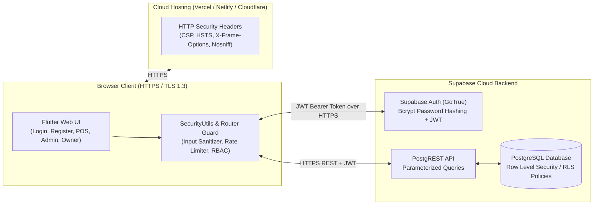

# POS Sakopi Saroja — Sistem Informasi Point of Sale & Manajemen Kedai Kopi Berbasis Web

Aplikasi **Point of Sale (POS) & Manajemen Keuangan Kedai Kopi** berbasis **Flutter Web** dan **Supabase (PostgreSQL + GoTrue Auth + Row Level Security)** yang dirancang dengan prinsip *Defense-in-Depth* untuk memenuhi Tugas Project Mata Kuliah **Cyber Security (Pengembangan & Pengamanan Aplikasi Web)**.

---

## 1. Deskripsi Aplikasi

**POS Sakopi Saroja** adalah aplikasi web siap pakai (*production-ready*) yang mengintegrasikan operasional kasir, manajemen inventori/menu oleh admin, serta pemantauan laporan keuangan dan pengelolaan hak akses staf oleh pemilik kedai (*Owner*) secara *real-time*. Selain menyediakan fungsionalitas bisnis utama (Autentikasi, CRUD Database, dan Ekspor Laporan PDF/Grafik), aplikasi ini menerapkan standar pengamanan aplikasi web modern sesuai pedoman **OWASP Top 10**.

---

## 2. Fitur Utama

### A. Registrasi, Autentikasi & Manajemen Sesi
- **Registrasi Akun Mandiri (`/register`):** Pengguna baru dapat mendaftar dengan validasi kekuatan kata sandi (*Strong Password Policy* & *Password Strength Meter*). Setiap pendaftaran mandiri secara otomatis dikunci pada hak akses standar (`kasir`) baik di sisi aplikasi maupun melalui *Database Trigger* untuk mencegah *Privilege Escalation*.
- **Login & Proteksi Brute-Force (`/login`):** Autentikasi berbasis JWT (*JSON Web Token*) dengan fitur **Login Rate Limiting** (maksimal 5 percobaan gagal berturut-turut sebelum akun/form dikunci selama 60 detik disertai *countdown timer*).
- **Validasi Masa Berlaku Sesi:** Pemeriksaan otomatis kedaluwarsa token (`session.isExpired`) dan penghapusan sesi saat *Logout*.

### B. Kontrol Akses Berdasarkan Peran (RBAC - 3 Role)
1. **Kasir (`kasir` - User Standar):**
   - Melihat katalog menu berdasarkan kategori & pencarian aman (*Anti-SQLi & Anti-XSS*).
   - Mengelola keranjang belanja, memilih metode pembayaran (`Tunai` / `Non-Tunai`), memproses transaksi, dan mencetak **Struk Pembayaran PDF**.
   - Memantau dan menyelesaikan antrean pesanan harian (*Queue*).
2. **Admin (`admin` - Pengelola Operasional):**
   - Melihat ringkasan operasional harian (Menu Aktif, Menu Habis, Total Transaksi Hari Ini).
   - **CRUD Produk/Menu:** Menambah, melihat, mengubah, menghapus menu, serta mengubah status ketersediaan (*Tersedia* / *Habis*).
   - Memantau 100 riwayat transaksi terakhir beserta rincian itemnya.
3. **Owner (`owner` - Pemilik Kedai):**
   - **Laporan & Dashboard Analitik:** Melihat Pendapatan Kotor, Beban Pengeluaran, Laba Bersih (*Net Profit*), Grafik Tren Penjualan Harian (`LineChart`), Grafik Proporsi Pembayaran (`PieChart`), dan **Top 5 Menu Terlaris** dari data aktual database.
   - **Ekspor Laporan PDF:** Mengunduh laporan keuangan resmi dalam format **PDF** berdasarkan filter periode (*Hari Ini*, *Minggu Ini*, *Bulan Ini*).
   - **CRUD Beban Pengeluaran (*Expenses*):** Mencatat, melihat, mengubah, dan menghapus pengeluaran operasional toko.
   - **CRUD Manajemen Akun Staf:** Mengelola profil dan mengubah peran (*role*) pegawai (`kasir`, `admin`, `owner`).

### C. Fitur Keamanan Berlapis (*Cyber Security Controls*)
- **Hashing Password Aman:** Menggunakan algoritma **Bcrypt** melalui layanan autentikasi Supabase GoTrue (tidak ada password yang disimpan dalam bentuk *plaintext*).
- **Validasi & Sanitasi Input (*Anti-SQLi & Anti-XSS*):** Modul `SecurityUtils` (`lib/core/utils/security_utils.dart`) memvalidasi dan menyaring seluruh *form input* serta parameter URL (`?q=...`) dari pola *SQL Injection* dan *Cross-Site Scripting (XSS)*, dilengkapi *parameterized queries* pada klien PostgREST.
- **Proteksi RBAC Berlapis & Anti-IDOR:**
  - *Frontend Route Guard* (`lib/core/routing/app_router.dart`) memblokir manipulasi URL antar-peran.
  - *Backend Row Level Security (RLS)* (`database_schema.sql`) memastikan pengguna biasa (`kasir`) tidak dapat mengakses API/tabel milik `admin` atau `owner` maupun memanipulasi `cashier_id` milik pengguna lain (*Anti-IDOR*).
- **Security Audit & Activity Log:** Modul `SecurityAuditLogger` mencatat seluruh aktivitas penting (login berhasil/gagal, *lockout rate limit*, percobaan XSS/SQLi yang diblokir, pelanggaran RBAC, dan aksi CRUD) yang dapat dipantau langsung melalui dialog **Security Log** di dalam aplikasi.
- **HTTP Security Headers:** Konfigurasi `vercel.json`, `netlify.toml`, dan `web/_headers` menyertakan `Strict-Transport-Security (HSTS)`, `Content-Security-Policy (CSP)`, `X-Frame-Options: DENY`, `X-Content-Type-Options: nosniff`, `Referrer-Policy`, dan `Permissions-Policy`.

---

## 3. Teknologi & Arsitektur

- **Frontend:** Flutter Web (Dart SDK `^3.12.2`), Material 3
- **State Management & Routing:** `flutter_riverpod` (`^3.3.2`) & `go_router` (`^17.3.0`)
- **Backend & Database:** Supabase (`PostgreSQL`, `GoTrue Auth`, `PostgREST`, `Row Level Security`)
- **Visualisasi & Ekspor Laporan:** `fl_chart` (`^1.2.0`), `pdf` (`^3.13.0`), `printing` (`^5.15.0`)
- **Pola Arsitektur:** *Feature-First Architecture* dengan *Repository Pattern* (`domain/`, `data/`, `presentation/`)



---

## 4. Konfigurasi Environment Variable (Tanpa Nilai Rahasia)

Aplikasi menyimpan kredensial koneksi di dalam *environment variable* dan tidak menuliskannya secara *hardcoded* di dalam *source code*. Salin berkas `.env.example` menjadi `.env`:

```env
SUPABASE_URL=https://your-project-id.supabase.co
SUPABASE_ANON_KEY=your-supabase-anon-public-key
```

> **Catatan Keamanan:** Berkas `.env` dan direktori `supabase/.temp/` telah dimasukkan ke dalam `.gitignore` sehingga tidak pernah ter-*commit* ke dalam riwayat *repository* Git.

---

## 5. Cara Instalasi dan Menjalankan Secara Lokal

### Prasyarat
- **Flutter SDK** (`>= 3.12.0`) dengan dukungan Web (*Chrome / Edge*)
- Akun & Proyek **Supabase** aktif

### Langkah-langkah
1. **Clone repository:**
   ```bash
   git clone <URL_REPOSITORY_GIT_ANDA>
   cd pos_sakopi
   ```
2. **Instal seluruh dependency:**
   ```bash
   flutter pub get
   ```
3. **Siapkan Environment Variable:**
   Salin `.env.example` menjadi `.env` lalu isi `SUPABASE_URL` dan `SUPABASE_ANON_KEY` dari *Project Settings -> API* di Supabase Dashboard.
4. **Inisialisasi Skema Database & Kebijakan RLS:**
   Salin seluruh isi berkas [`database_schema.sql`](./database_schema.sql) dan jalankan di menu **SQL Editor** pada Supabase Dashboard Anda (ini akan membuat tabel, *trigger* registrasi, serta mengaktifkan *Row Level Security*).
5. **Jalankan pengujian keamanan otomatis (Unit & Security Tests):**
   ```bash
   flutter test
   ```
6. **Jalankan aplikasi di Browser (Lokal):**
   ```bash
   flutter run -d chrome
   ```
7. **Build untuk Produksi (Web Deployment):**
   ```bash
   flutter build web --release --dart-define=SUPABASE_URL=https://your-project-id.supabase.co --dart-define=SUPABASE_ANON_KEY=your-anon-key
   ```

---

## 6. URL Aplikasi & Akun Uji Coba

- **URL Aplikasi Aktif (HTTPS):** https://sakopisaroja.netlify.app
- **Akun Uji Coba (Demo):**
  - **Owner (Akses Penuh & Laporan):** `owner@sakopi.com` | Password: *(Lihat dokumen laporan PDF EdLink)*
  - **Admin (Manajemen Menu & Transaksi):** `admin@sakopi.com` | Password: *(Lihat dokumen laporan PDF EdLink)*
  - **Kasir (POS & Antrean):** `kasir@sakopi.com` | Password: *(Lihat dokumen laporan PDF EdLink)*

---

## 7. Ringkasan Penggunaan AI Agent

Pengembangan dan pengamanan aplikasi ini dibantu oleh **AI Agent (Google Antigravity / Gemini)** sesuai ketentuan perkuliahan:

- **Bagian yang Dibantu:**
  1. Perancangan struktur *Feature-First Repository Pattern* dengan Riverpod & GoRouter.
  2. Pembuatan modul validasi & sanitasi input (`SecurityUtils`), *Login Rate Limiter*, serta *Security Audit Logger*.
  3. Penyusunan kebijakan *Row Level Security (RLS)* PostgreSQL pada `database_schema.sql` untuk mencegah kerentanan IDOR dan *Privilege Escalation*.
  4. Penyusunan skenario *Self-Testing Keamanan* (`test/widget_test.dart`) dan konfigurasi *HTTP Security Headers* (`vercel.json` / `netlify.toml`).
- **Contoh Prompt Utama:**
  - *"Bantu saya meneliti ketentuan tugas Cyber Security pada aplikasi POS Sakopi Saroja, perbaiki celah keamanan seperti Broken Access Control pada GoRouter, tambahkan fitur Registrasi dengan validasi password kuat dan rate limiting login, terapkan validasi anti-SQLi dan anti-XSS pada seluruh form dan parameter URL, serta lengkapi kebijakan Row Level Security (RLS) di PostgreSQL Supabase."*
- **Verifikasi Manual oleh Mahasiswa:**
  Seluruh kode hasil AI telah ditinjau baris demi baris, terutama pada alur autentikasi Supabase (`supabase_auth_repository.dart`), logika penguncian *brute-force* (`auth_controller.dart`), sanitasi input (`security_utils.dart`), dan kebijakan RLS SQL (`database_schema.sql`), serta diuji langsung melalui browser dan `flutter test`. Tidak ada *secret* atau API key nyata yang dimasukkan ke dalam prompt AI.

---

## 8. Ringkasan Hasil Self-Testing Keamanan

Pengujian keamanan mandiri (*self-testing*) telah dilakukan mencakup 6 skenario utama:

| No | Skenario Uji | Cara Uji | Kondisi Sebelum Perbaikan | Hasil Akhir (Sesudah Perbaikan) |
| :--- | :--- | :--- | :--- | :--- |
| **1** | **SQL Injection pada Form Input & Email** | Memasukkan payload `' OR '1'='1` dan `Kopi'; DROP TABLE products;--` pada form Login, Pencarian POS, dan Tambah Menu. | Input tidak divalidasi di sisi form sebelum dikirim ke API. | **LOLOS (Aman)** — Ditolak oleh `SecurityUtils.validateSafeText` / `validateEmail`, menggunakan *parameterized queries*, dan dicatat sebagai `SQLI_ATTEMPT_BLOCKED` di Security Log. |
| **2** | **Cross-Site Scripting (XSS) pada Form & Parameter URL** | Memasukkan `<script>alert('XSS')</script>` pada form Pengeluaran/Menu serta mengakses URL `/cashier?q=<script>alert(1)</script>`. | Form menerima tag HTML/script mentah dan URL tidak diinspeksi. | **LOLOS (Aman)** — Payload XSS pada form dan parameter URL langsung diblokir & dibersihkan oleh `SecurityUtils` dan Router Guard (`URL_PARAM_ATTACK_BLOCKED`). |
| **3** | **Kontrol Akses (RBAC) & Pencegahan IDOR** | Login sebagai `kasir`, lalu mencoba mengubah URL browser ke `/admin` atau `/owner`, serta mencoba mengubah data `expenses` / `users_profile` milik user lain. | **GAGAL (Rentan)** — `app_router.dart` hanya mengecek role saat di `/login` dan tabel Supabase belum memiliki RLS. | **LOLOS (Aman)** — `app_router.dart` memblokir akses lintas-role di setiap rute (`RBAC_UNAUTHORIZED_ACCESS`), dan kebijakan RLS PostgreSQL menolak akses API ilegal/IDOR. |
| **4** | **Autentikasi: Password Lemah, Rate Limiting Login & Sesi** | Mendaftar dengan password lemah (`12345`, `password123`), mencoba login salah 5 kali berturut-turut, dan menguji Logout. | Belum ada halaman registrasi, tidak ada penolakan password lemah, dan belum ada *rate limit* login di UI. | **LOLOS (Aman)** — Password lemah ditolak oleh `validateStrongPassword`, login gagal 5x mengunci form selama 60 detik (`AUTH_BRUTEFORCE_LOCKOUT`), dan sesi kedaluwarsa otomatis di-logout. |
| **5** | **HTTPS & Security Headers** | Memeriksa sertifikat SSL/TLS (HTTPS) pada domain hosting dan memindai header keamanan (`HSTS`, `CSP`, `X-Frame-Options`, `X-Content-Type-Options`). | Belum ada konfigurasi header keamanan pada `vercel.json` / `netlify.toml`. | **LOLOS (Aman)** — Aplikasi berjalan di atas HTTPS valid dengan konfigurasi *Security Headers* lengkap (`HSTS`, `CSP`, `DENY`, `nosniff`). |
| **6** | **Pengelolaan Secret & Audit Dependency** | Memeriksa riwayat Git terhadap file `.env` dan mengecek kerentanan paket dengan `flutter pub outdated` / *dependency audit*. | Direktori `supabase/.temp/` belum tercantum di `.gitignore`. | **LOLOS (Aman)** — `.env` dan `supabase/.temp/` diabaikan di `.gitignore`, disediakan `.env.example` tanpa nilai rahasia, dan seluruh paket menggunakan versi stabil terbaru. |

---
*Disusun oleh: **Evan Maulana** — Proyek Mata Kuliah Cyber Security*
